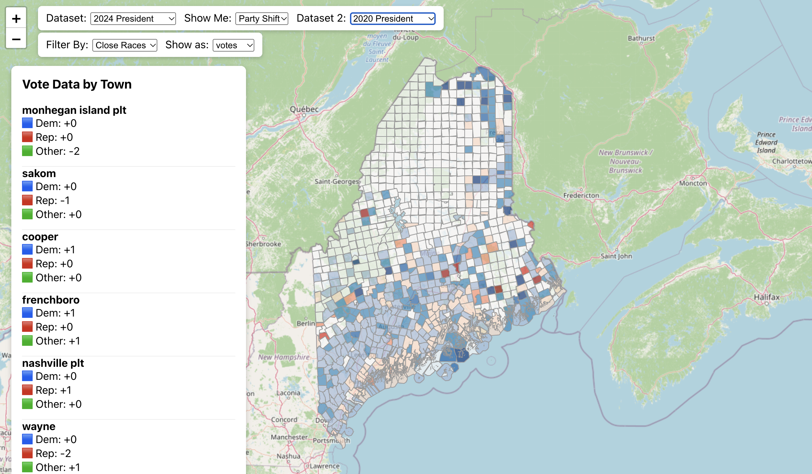

# Maine Elections Visualizer

An interactive map of Maine election results at the town level. Pick an election to see how each of Maine's towns voted, or compare two elections to see where support shifted.



## Features

- **Town-level choropleth map** of the 2020 and 2024 presidential, 2024 U.S. Senate, and 2024 State Senate results
- **Party shift comparison** between any two elections
- **Sortable town list** showing the closest races or the strongest Democratic or Republican towns, in votes or percentages
- **Fuzzy name matching** that connects town names in the election data to the names in the boundary data

## Tech stack

- **Frontend:** React, Leaflet (via React Leaflet), Axios
- **Backend:** Node.js, Express
- **Database:** PostgreSQL, run locally with Docker Compose

## Quick start

You'll need [Node.js](https://nodejs.org/) and [Docker](https://www.docker.com/).

```bash
cp server/.env.example server/.env   # default settings for the Docker database
docker compose up -d                 # start Postgres
npm run setup                        # install dependencies
npm run db:seed                      # load the election data
npm start                            # start the API and the React app
```

The app opens at <http://localhost:3000>, and the API runs on port 5002.

To use your own Postgres instead of Docker, skip `docker compose up` and point `server/.env` at your database.

## Adding an election

1. Add a CSV at `data/<election_id>.csv`. It needs `cty` and `municipality` columns, a column for each vote total, and a `tbc` (total ballots cast) column. The header names become the database column names.
2. Add an entry to `server/config/elections.js` with the table name and the Democratic, Republican, and total columns.
3. Add a matching entry to `client/src/config/elections.js`.
4. Import it with `npm run db:seed -- <election_id>`.

## Project layout

```
client/                 React app
  src/config/           Elections shown in the UI
  src/data_views/       Map, comparison, and town list views
  src/infrastructure/   Boundary loading and town name matching
  src/utils/            Vote data helpers
server/                 Express API
  config/               Election definitions and SQL query builders
  scripts/              CSV importer
data/                   Election results as CSV
```

## Data

- **Election results:** town-level tabulations from the Maine Secretary of State
- **Town boundaries:** [Maine Town and Townships Boundary Polygons](https://services1.arcgis.com/RbMX0mRVOFNTdLzd/arcgis/rest/services/Maine_Town_and_Townships_Boundary_Polygons/FeatureServer/0), loaded from ArcGIS in the browser
- **Map tiles:** © [OpenStreetMap](https://www.openstreetmap.org/copyright) contributors

Some towns and townships report their results together. The 2024 presidential data lists these places separately, and each one repeats the combined total. For example, Caribou and Connor both show the same 1,553 Democratic votes, so summing towns will overstate the statewide count.

## License

[MIT](LICENSE)
